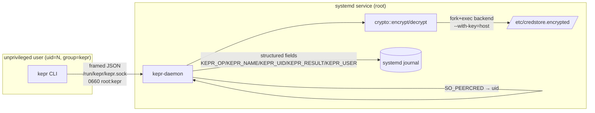
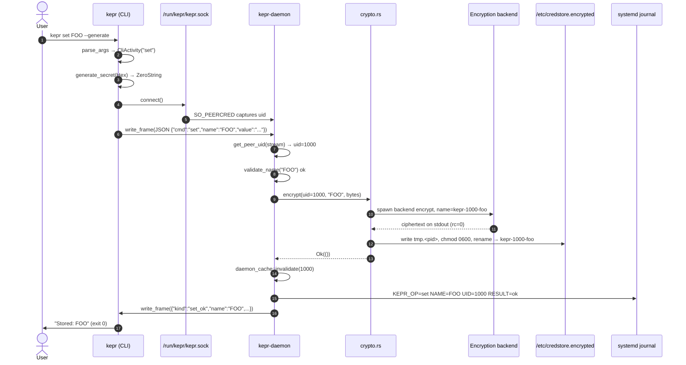
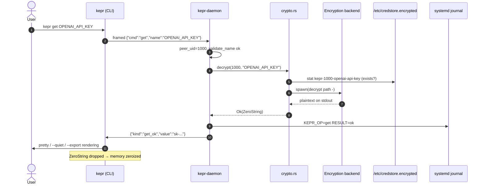
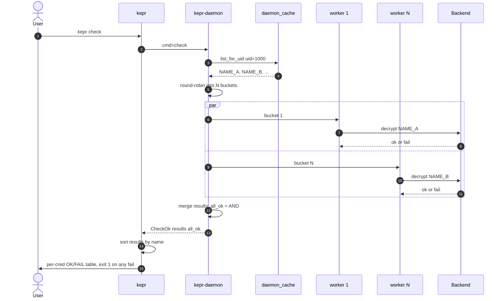
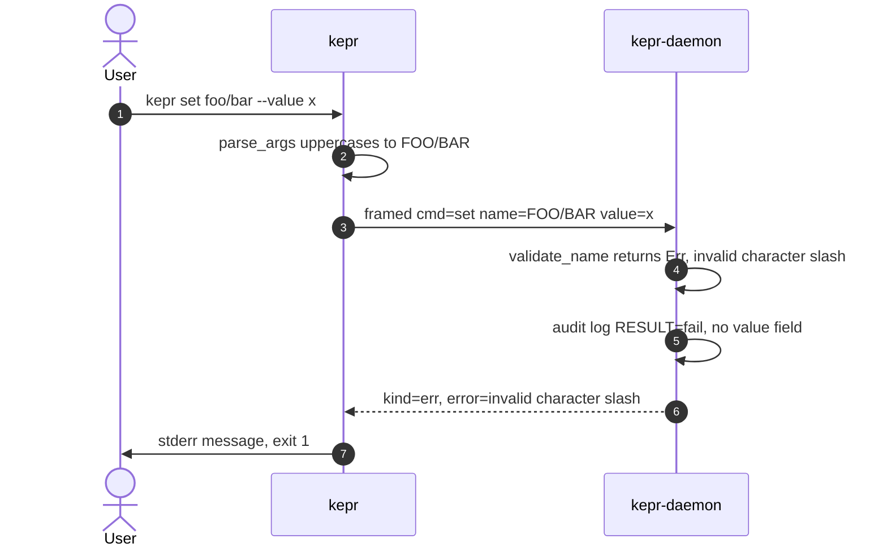
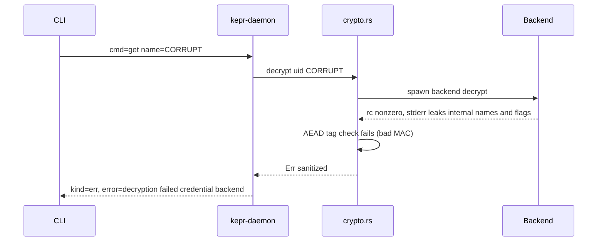
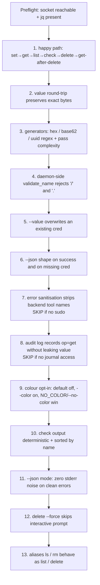

# kepr — Technical Documentation

A per-user credential manager for Linux hosts. An unprivileged CLI talks
to a root systemd service over a Unix socket; the daemon owns all
encryption, decryption, audit logging, and on-disk state.

---

## 1. Architecture

### 1.1 Process model

Two binaries built from one crate (`Cargo.toml` declares both `[[bin]]`
targets):

| Binary           | UID     | Responsibilities                                              |
| ---------------- | ------- | ------------------------------------------------------------- |
| `kepr`        | caller  | Argv parsing, terminal UI, framed JSON over `/run/kepr`.   |
| `kepr-daemon` | `root`  | Encryption backend, peer-uid enforcement, audit log, fs I/O.  |

The CLI **never** invokes the encryption backend, **never** touches
`/etc/credstore.encrypted/`, and **never** needs `sudo`. Membership in
the `kepr` group is the sole client-side prerequisite.

### 1.2 Trust boundary



The boundary is the socket. The daemon **discards any uid in the request
body** and uses the `SO_PEERCRED`-reported uid for namespacing; that
makes the `kepr-<uid>-<name>` scheme tamper-proof from the wire side.

### 1.3 On-disk layout

```
/etc/credstore.encrypted/
├── kepr-1000-openai-api-key      ← uid 1000
├── kepr-1000-stripe-secret
├── kepr-1001-openai-api-key      ← uid 1001 (different file, same name)
└── kepr-0-host-token

/run/kepr/kepr.sock              0660 root:kepr
/usr/local/bin/kepr                 0755 root:root
/usr/local/sbin/kepr-daemon         0700 root:root
```

The encryption backend persists its host-derived key under
`/var/lib/systemd/`; the systemd unit allow-lists that path
(`ReadWritePaths=`) so first-run key seeding survives `ProtectSystem=strict`.

### 1.4 Module split

| Module                 | Owner          | Purpose                                                  |
| ---------------------- | -------------- | -------------------------------------------------------- |
| `protocol.rs`          | both           | `Request`/`Response` enums, socket path, `MAX_MSG_BYTES`.|
| `framing.rs`           | both           | `<u32 BE len><payload>` codec.                           |
| `generate.rs`          | both           | `ZeroString` (zeroed-on-drop), CSPRNG with rejection sampling. |
| `store.rs`             | both           | Naming, validation, path helpers.                        |
| `client.rs`            | CLI            | `send_request` (connect → write_frame → read_frame).     |
| `cli_*.rs`             | CLI            | Argv parsing, mode flags, terminal IO.                   |
| `crypto.rs`            | daemon         | Backend seam; fail-closed until start-up; lookup errors. |
| `audit.rs`             | daemon         | Journal datagram (cached fd) with `KEPR_*` fields.    |
| `daemon_*.rs`          | daemon         | Socket setup, peer creds, worker pool, dir cache, handlers. |

`mod` declarations in `main.rs` and `daemon.rs` enforce this split: the
CLI binary cannot import `crypto` or `audit` because they are not
declared in its module tree.

---

## 2. Design Patterns

### 2.1 Tagged enums on the wire

Both `Request` and `Response` use `#[serde(tag = "...")]` so adding an
operation is exactly one new variant — there is no god-struct of
`Option<...>` fields.

```rust
#[serde(tag = "cmd", rename_all = "lowercase")]
pub enum Request { Set { … }, Get { … }, List, Delete { … }, Check, Ping }

#[serde(tag = "kind", rename_all = "snake_case")]
pub enum Response { SetOk { … }, GetOk { … }, ListOk { … }, … , Err { error } }
```

`Response::is_success()` distinguishes **transport** success from
**semantic** success: `CheckOk { all_ok: false }` is a valid reply but
exits the CLI non-zero.

### 2.2 Newtype with constructor enforcement

`CliActivity(String)` can only be built through `CliActivity::parse`,
which resolves aliases (`ls`→`list`, `rm`→`delete`) and rejects unknown
verbs. `dispatch()` then has an irrefutable five-arm match plus
`unreachable!()` — the type system, not a runtime check, guarantees the
default arm cannot fire.

### 2.3 Zeroed-on-drop secrets

`ZeroString` wraps `String` and impls `Drop` via `zeroize::Zeroize`. All
cleartext secret material flows through this type: generated values,
decrypted plaintext, masked terminal input. The plain `String`
representation only escapes at the JSON boundary (`to_owned_string()`).

### 2.4 Peer-credential authorisation

```rust
let peer_uid = get_peer_uid(&stream)?;          // SO_PEERCRED
let response = dispatch(peer_uid, &username, request);
```

Authorisation is **kernel-attested**. The uid in the dispatch path is
the connect(2)-time uid of the peer process — it is never read from the
JSON payload.

### 2.5 Bounded worker pool with backpressure

`daemon_pool::Pool` is a fixed `POOL_WORKERS=16` thread pool fed by a
`SyncSender` of capacity `POOL_QUEUE=64`. When the queue is full,
`SyncSender::send` blocks the accept loop, which parks accept(2) and
lets the kernel listen-backlog absorb the burst. No `thread::spawn` per
connection → no pthread-stack OOM under flood.

### 2.6 Atomic write via temp + rename

`crypto::encrypt` writes the ciphertext to `<path>.tmp.<pid>` in the
same directory, `chmod 0600`, then `rename(2)` over the destination.
Concurrent `set NAME` calls cannot interleave: a reader sees either the
old file or the whole new one — never a partial.

### 2.7 Cached directory listing with write-through invalidation

`daemon_cache.rs` keeps a per-uid `Vec<(String, PathBuf)>` behind an
`RwLock`. The daemon owns *all* writes to the credstore, so cache
invalidation is trivial — `handle_set` and `handle_delete` call
`invalidate(uid)`. Read-heavy workloads avoid `read_dir` of a directory
that scales with all users on the host.

### 2.8 Error sanitisation at the boundary

Credential operations run in-process (AES-256-GCM), so no backend
stderr reaches users at all; the one subprocess, the master-key sealer at
start-up, reports only "seal failed" / "unseal failed".
`crypto::sanitize_lookup_error` collapses "not found" and "cannot
decrypt" into one message so names can't be probed. The systemd unit uses
a neutral `SyslogIdentifier` for the same reason. Treat any new error
string as user-visible.

### 2.9 Process-wide CLI mode via `OnceLock`

`cli_mode::CliMode { json, color }` is set once during `parse_args` from
argv + environment with documented precedence
(`NO_COLOR` > `--no-color` > `CLICOLOR_FORCE` > `--color` > default off).
Every early-exit path (unknown verb, missing flag value) reads the same
`mode()` snapshot, so `--json` errors never leak ANSI to stderr.

### 2.10 Length-prefixed framing

```
┌──────────────┬────────────────────────────┐
│ u32 BE len   │ JSON payload (≤ 64 KiB)    │
└──────────────┴────────────────────────────┘
```

`read_exact` on the 4-byte header eliminates the silent-truncation
failure mode of "read once into a big buffer" and bounds memory.

---

## 3. Features

### 3.1 Command surface

| Verb     | Aliases | Args                                            | Output                |
| -------- | ------- | ----------------------------------------------- | --------------------- |
| `set`    |         | `KEY [--generate] [--value V] [--gen-kind ...]` | `SetOk`               |
| `get`    |         | `KEY [--quiet] [--export]`                      | `GetOk { value }`     |
| `list`   | `ls`    | —                                               | `ListOk { credentials }` |
| `delete` | `rm`    | `KEY [--force]`                                 | `DeleteOk`            |
| `check`  |         | —                                               | `CheckOk { all_ok }`  |

Global flags: `--json` (machine output, suppress stderr on clean
errors), `--color` / `--no-color` (opt-in ANSI), `--version`, `--help`.

### 3.2 Generators (`--gen-kind`)

| Kind     | Length | Alphabet / Format                                  |
| -------- | ------ | -------------------------------------------------- |
| `hex`    | 64     | `[0-9a-f]` from 32 random bytes                    |
| `base62` | 48     | `[A-Za-z0-9]`, rejection-sampled (no modulo bias)  |
| `pass`   | 32     | upper + lower + digit + symbol (retry until all 4) |
| `uuid`   | 36     | RFC 4122 v4 (version + variant nibbles enforced)   |

All entropy comes from `/dev/urandom`; the rejection-sampling helper
discards bytes ≥ `(256 / |alphabet|) * |alphabet|` to stay uniform.

### 3.3 Audit log

Every operation emits a structured journal datagram via a cached
`UnixDatagram` fd:

```
SYSLOG_IDENTIFIER=kepr-daemon
PRIORITY=6 | 3
MESSAGE=kepr: op=get name=OPENAI_API_KEY uid=1000 user=kk result=ok
KEPR_OP=get
KEPR_NAME=OPENAI_API_KEY
KEPR_UID=1000
KEPR_USER=kk
KEPR_RESULT=ok
```

Indexed query examples:

```bash
journalctl -t kepr-daemon
journalctl -t kepr-daemon KEPR_UID=1000
journalctl -t kepr-daemon KEPR_OP=get KEPR_RESULT=fail
```

The credential **value is never logged.**

The daemon also maintains a hash-chained append-only record at
`/var/lib/kepr/audit.log`. Startup verifies the complete chain. If a
process dies while appending, the final line that lacks its terminating
newline is dropped; every complete line is still verified, and a
newline-terminated malformed record remains a hard startup failure so
edits and reordering are not silently accepted.

### 3.4 Hardening (`systemd/kepr.service`)

`ProtectSystem=strict`, `ProtectHome=yes`, `PrivateTmp=yes`,
`ProtectKernelTunables=yes`, `ProtectKernelModules=yes`,
`ProtectControlGroups=yes`, `RestrictNamespaces=yes`,
`LockPersonality=yes`, `MemoryDenyWriteExecute=yes`,
`RestrictRealtime=yes`, `RestrictSUIDSGID=yes`. `mlockall(MCL_CURRENT |
MCL_FUTURE)` keeps decrypted bytes off swap; the daemon also disables core
dumps and ptrace attachment (`prctl(PR_SET_DUMPABLE, 0)`) before touching
any secret material. `NoNewPrivileges=yes` — the in-process AEAD backend
means the daemon never needs to gain new privileges at runtime; the one
`systemd-creds` invocation at startup runs as root already, the same as
the daemon itself.

---

## 4. Sequence Diagrams

### 4.1 `kepr set FOO --generate`



### 4.2 `kepr get OPENAI_API_KEY`



### 4.3 `kepr check` (parallel verify)



### 4.4 Rejected request — invalid name



The check runs **inside the daemon**, not just on the client — the
client uppercase-folds positional args but the daemon's `validate_name`
is the actual security boundary against path traversal and shell
metachars.

### 4.5 Decrypt failure with sanitised error



---

## 5. Test Cases

### 5.1 Unit tests (`cargo test`)

Hermetic — no daemon, no root, no encryption backend.

| Module          | Test                                  | Asserts                                                    |
| --------------- | ------------------------------------- | ---------------------------------------------------------- |
| `protocol`      | `request_wire_tag_is_lowercase_cmd`   | `cmd` field stays lowercase across all variants.           |
| `protocol`      | `request_roundtrip_preserves_all_variants` | Serialize → deserialize is identity.                  |
| `protocol`      | `set_optional_fields_omitted_when_none` | `value`/`generate` skipped when `None`.                  |
| `protocol`      | `response_check_all_ok_drives_is_success` | Transport-ok + semantic-fail composes correctly.      |
| `store`         | `cred_name_format` / `_roundtrip`     | `to_cred_name` / `from_cred_name` are inverses.            |
| `store`         | `from_cred_name_reverses_dash_mapping`| Pins `_↔-` substitution; regression would break `list`/`get`. |
| `store`         | `validate_name_accepts_valid` / `_rejects_invalid` | 128-char cap; rejects `/`, `..`, NUL, non-ASCII, whitespace. |
| `store`         | `format_timestamp_known_values`       | Calendar math vs. `1700000000` epoch.                      |
| `generate`      | `gen_kind_roundtrip`                  | `as_str ↔ from_str` (case-sensitive on the wire).          |
| `generate`      | `hex_format` / `base62_format`        | Length + alphabet conformance.                             |
| `generate`      | `pass_format`                         | upper + lower + digit + symbol present (8 samples).        |
| `generate`      | `uuid_v4_format`                      | Length 36, version `4`, variant `[89ab]`, all hex elsewhere. |
| `framing`       | `roundtrip_small`                     | `<u32 BE><payload>` codec.                                 |
| `framing`       | `rejects_oversized_frame`             | `n > max` returns `InvalidData`.                           |
| `framing`       | `partial_read_is_reassembled`         | `read_exact` loops over fragmented streams.                |
| `cli_mode`      | precedence tests                      | `NO_COLOR > --no-color > CLICOLOR_FORCE > --color > off`.  |
| `cli_activity`  | `parse_resolves_aliases` / `_rejects_unknown` | `ls`→list, `rm`→delete; unknown returns `Err`.     |

`store::tests` only compile under the `kepr-daemon` bin target — see
the `mod` declarations.

### 5.2 End-to-end tests (`tests/e2e.sh`)

Requires the installed daemon, `kepr` group membership, and `jq`.
Cases 7 + 8 skip cleanly without sudo / journal-read access. Each cred
created uses prefix `E2E_<pid>_<epoch>_` and is removed on `trap EXIT`.



Run:

```bash
sudo systemctl status kepr           # daemon up
newgrp kepr                          # group active in this shell
./tests/e2e.sh                          # exit 0 = full pass
```

### 5.3 Coverage matrix

| Concern                          | Unit                       | E2E      |
| -------------------------------- | -------------------------- | -------- |
| Wire format stability            | `protocol::tests`          | 6, 11    |
| Naming + path-traversal defence  | `store::validate_name_*`   | 4        |
| Generator format guarantees      | `generate::tests`          | 3        |
| Atomic write / overwrite         | —                          | 5        |
| Per-cred decrypt success         | —                          | 1, 10    |
| Sanitised error path             | —                          | 7        |
| Audit log without value leak     | —                          | 8        |
| Colour precedence                | `cli_mode::tests`          | 9        |
| `--json` stderr hygiene          | —                          | 11       |
| Alias dispatch                   | `cli_activity::tests`      | 13       |
| Framing fragmentation            | `framing::tests`           | (implicit) |

---

## 6. Reference

- `README.md` — install, usage, file layout, troubleshooting.
- `systemd/kepr.service` — hardening flags + `ReadWritePaths` allow-list.
- `tests/e2e.sh` — see §5.2.
