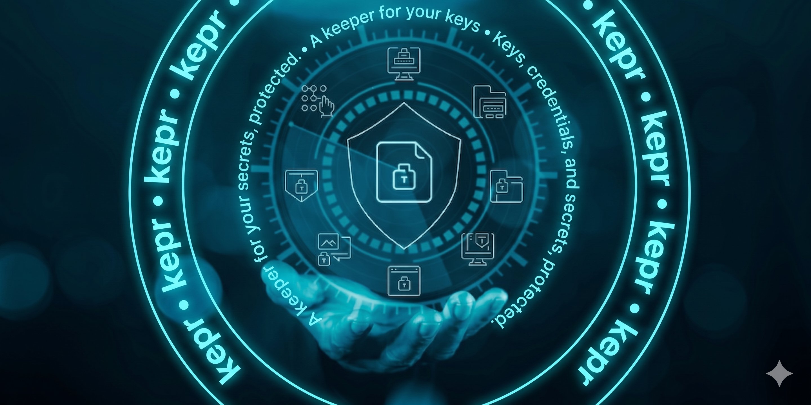
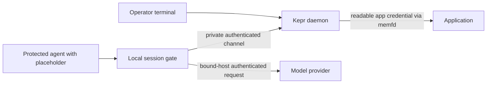

# Kepr — Sealed Credentials for Applications and Agents

Kepr is a Linux-first credential vault with a CLI, local daemon, agent gate,
Git/Docker credential helpers, and an optional Kubernetes ESO provider.
Applications can receive readable credentials through sealed memory descriptors.
Protected AI sessions instead receive placeholders: the gate uses sealed keys
only for their bound destinations, without giving the agent the stored values.
<p align="center">
  
</p>




The default Linux user socket is `/run/user/<uid>/kepr/kepr.sock`; the optional
root-managed system daemon uses `/run/kepr/kepr.sock`. A local gate does not
make cloud inference offline or anonymous.

---

## Credential Delivery Boundaries

| Workflow | Command | Who receives the real value? |
| --- | --- | --- |
| Application integration | `kepr exec --memfd NAME -- COMMAND` | The application can read it from an inherited descriptor. |
| Protected agent session | `kepr agent run HARNESS` | The daemon/gate use it; the harness receives a session placeholder. |
| Legacy agent injection | `kepr protect-agent` | The agent can read the injected value; this is not the sealed-key boundary. |

---

## Features

- **Protected agent sessions**: OMP, Grok Build, community grok-cli, Codex and
  other supported harnesses use host-bound sealed credentials. Protected
  launches require sandbox/network isolation and a private workspace snapshot;
  unsupported protection fails closed rather than silently downgrading.
- **Reviewed workspace changes**: `kepr workspace review` produces a diff and
  approval digest; `kepr workspace export` writes an approved result to a new
  directory instead of editing the original project in place.
- **Bounded local privacy**: `private-cloud` masks supported text schemas before
  forwarding. It is not an anonymity guarantee or device-wide firewall.
  `local-only` currently refuses to launch because local inference routing is
  not implemented.
- **Scoped MCP access**: explicit credential/SSH-key grants, read-only database
  defaults, finite budgets, and no silent reauthorization after a gate ends.
- **Linux endpoint scanning**: an optional ClamAV/bubblewrap adapter stages one
  immutable file without scanner network access. Missing/unqualified engines
  and incomplete scans are not reported as clean; quarantine is not implemented.
- **Platform limits**: Linux is the implemented protection path. Default
  macOS/Windows keyring backends fail closed until native storage is implemented;
  native sandbox/network enforcement is not qualified on those platforms.
- **Master Key Security**: Argon2id passphrase protection (`kepr lock` / `kepr unlock`) with in-process AES-256-GCM encryption and zeroized buffers.
- **Universal Integrations**: `git-credential-kepr` (Git HTTP auth), `docker-credential-kepr` (Docker login), `.envrc` (`direnv`), and `kepr-eso-provider` (Kubernetes External Secrets Operator).
- **FIDO2 Hardware Auth**: Require a hardware-key touch for supported readable
  credentials; sealed provider credentials do not currently support that combination.
- **SSH Key Management (`kepr ssh` / `kepr ssh-agent`)**: Ed25519 signing keys and Git authentication keys (e.g. `SSH_KEY_ID_ED25519`) are stored encrypted in the kepr credential backend. Private keys never touch disk in plaintext and are accessed sign-only via `kepr ssh-agent` or loaded dynamically by authorized processes.

---

## Quickstart

### Installation

```bash
# Clone and run hermetic installer
git clone https://github.com/aikepeer/kepr.git && cd kepr
./install.sh
```

The installer builds and installs `kepr`, `kepr-daemon`, `kepr-gate`, and both
credential helpers to `/usr/local/bin`. It restarts the system daemon and gate
service on systemd, or the selected per-user daemon otherwise, including
`--login` installations. Linux user-mode restart requires Python 3.9 or newer.
Restarting ends active agent gates but does not reset the vault; a protected
store may need `kepr unlock` afterward.

### Basic Usage

For an application that supports Kepr's `KEPR_FD_NAME` descriptors:

```bash
kepr set APP_TOKEN                       # masked terminal input
kepr exec --memfd APP_TOKEN -- your-app  # app reads KEPR_FD_APP_TOKEN
```

For an agent, store only the provider credentials you need, in your own terminal:

```bash
kepr agent add ANTHROPIC_API_KEY --for anthropic
kepr agent add XAI_API_KEY --for xai
kepr agent add OPENAI_API_KEY --for openai

kepr agent install omp                  # one-time plugin/config integration
kepr agent install grok                 # Grok Build, not community grok-cli

kepr agent run omp                      # from the project directory
kepr agent run grok
kepr agent run codex
```

Each `agent add` reads hidden input, seals the value, and binds its permitted
destination. `kepr agent ls` lists names/bindings, not values. `kepr get` refusing
a sealed key is expected. Codex uses its selected API provider's sealed key;
an existing Selora profile can be launched with
`kepr agent run codex -- codex --profile selora`. Community grok-cli uses
`kepr agent run grok-cli` instead of the Grok Build integration.

Protected runs edit a private copy. Keep the announced session identifier and
review/export its changes afterward; see the [agent guide](docs/content/docs/guides/ai-agents.mdx).
Explicit `--compatibility` weakens protection and is not a recommended workaround.

`kepr lock` / `kepr unlock` manage vault passphrase protection; they do not make
sealed entries readable. A vault that reports unlocked can still have a separate
ciphertext authentication failure. Preserve its credentials and original key or
recovery material; do not reset the vault or overwrite entries to troubleshoot it.
After recovery, `kepr check` verifies decryption without printing values. Add or
replace keys only once the vault is healthy, using hidden terminal prompts—not
command arguments, `.env`, harness config files, or chat.

Use bare option names such as `generate`, `quiet`, and `env`. Existing forms
with a `--` prefix (such as `--generate`, `--quiet`, and `--env`) remain
accepted. See `kepr help COMMAND` for each command's usage.

Help forms do not contact the daemon. The `--` separator before a child command
is optional for `exec` and `protect-agent`. `kepr-daemon help` documents daemon
startup; credential operations remain on the `kepr` client.

Install the user-local Bash completion for both binaries:

```bash
install -D -m 0644 completions/kepr.bash \
  "$HOME/.local/share/bash-completion/completions/kepr"
install -D -m 0644 completions/kepr.bash \
  "$HOME/.local/share/bash-completion/completions/kepr-daemon"
```

---

## Integrations

### Git Credential Helper
```bash
git config --global credential.helper kepr
```

### Docker Credential Helper
In `~/.docker/config.json`:
```json
{
  "credsStore": "kepr"
}
```

### Direnv Integration (`.envrc`)
In your project `.envrc`:
```bash
source_env completions/kepr.envrc
use_kepr OPENAI_API_KEY ANTHROPIC_API_KEY
```

---

## Security Architecture & Invariants

1. **Encrypted credentials**: Values use AES-256-GCM. Linux user mode defaults
   to an owner-only local master-key file; `kepr lock` adds Argon2id passphrase
   protection. A missing master key never triggers replacement generation over
   a nonempty credential store.
2. **Distinct exposure boundaries**: Memfd delivery avoids putting values in
   environment tables but the receiving application can read them. Sealed agent
   credentials are instead consumed by the destination-bound gate.
3. **Kernel-attested peers**: The daemon authenticates local client identity.
   Native Windows secret storage/IPC and macOS protection remain separate
   implementation and qualification work, not implied by shared interfaces.
4. **Durable gate decisions**: Metadata-only intents are persisted before the
   inspected gate HTTP request is forwarded, results are paired by intent ID,
   and missing results reconcile to `Unknown` on daemon startup.
5. **Memory handling and limits**: Sensitive buffers use zeroizing storage;
   this does not establish anonymity, protect an already compromised host, or
   prevent all private information from being encoded into outbound requests.

---

## Documentation

Comprehensive documentation lives at **[https://kepr.dev](https://kepr.dev)** (source in `docs/` built with Fumadocs / Next.js 15):

- [Architecture & Threat Model](docs/content/docs/architecture/overview.mdx)
- [RAM Delivery Strategy (`memfd`)](docs/content/docs/architecture/ram-delivery.mdx)
- [AI Agent Protection Guide](docs/content/docs/guides/ai-agents.mdx)
- [Kubernetes ESO Integration](docs/content/docs/guides/kubernetes-eso.mdx)
- [Security implementation and remaining gaps](docs/content/docs/security-suite-plan.mdx)
- [Current and target agent security flow](docs/content/docs/agent-security-flow.mdx)

---

## License

Dual-licensed under [MIT](LICENSE-MIT) or [Apache-2.0](LICENSE-APACHE).
