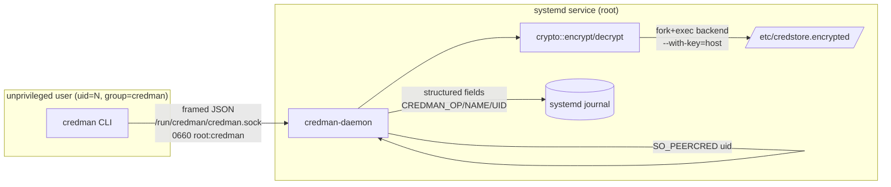

## Process model

Two binaries built from one crate (`Cargo.toml` declares both `[[bin]]`
targets):

| Binary           | UID     | Responsibilities                                              |
| ---------------- | ------- | ------------------------------------------------------------- |
| `credman`        | caller  | Argv parsing, terminal UI, framed JSON over `/run/credman`.   |
| `credman-daemon` | `root`  | Encryption backend, peer-uid enforcement, audit log, fs I/O.  |

The CLI **never** invokes the encryption backend, **never** touches
`/etc/credstore.encrypted/`, and **never** needs `sudo`. Membership in
the `credman` group is the sole client-side prerequisite.

## Trust boundary



The boundary is the socket. The daemon **discards any uid in the request
body** and uses the `SO_PEERCRED`-reported uid for namespacing; that
makes the `credman-<uid>-<name>` scheme tamper-proof from the wire side.

## On-disk layout

```
/etc/credstore.encrypted/
├── credman-1000-openai-api-key      ← uid 1000
├── credman-1000-stripe-secret
├── credman-1001-openai-api-key      ← uid 1001 (different file, same name)
└── credman-0-host-token

/run/credman/credman.sock              0660 root:credman
/usr/local/bin/credman                 0755 root:root
/usr/local/sbin/credman-daemon         0700 root:root
```

The encryption backend persists its host-derived key under
`/var/lib/systemd/`; the systemd unit allow-lists that path
(`ReadWritePaths=`) so first-run key seeding survives `ProtectSystem=strict`.

## Module split

| Module                 | Owner          | Purpose                                                  |
| ---------------------- | -------------- | -------------------------------------------------------- |
| `protocol.rs`          | both           | `Request`/`Response` enums, socket path, `MAX_MSG_BYTES`.|
| `framing.rs`           | both           | `<u32 BE len><payload>` codec.                           |
| `generate.rs`          | both           | `ZeroString` (zeroed-on-drop), CSPRNG with rejection sampling. |
| `store.rs`             | both           | Naming, validation, path helpers.                        |
| `client.rs`            | CLI            | `send_request` (connect → write_frame → read_frame).     |
| `cli_*.rs`             | CLI            | Argv parsing, mode flags, terminal IO.                   |
| `crypto.rs`            | daemon         | Encryption-backend wrapper; `sanitize_error`.            |
| `audit.rs`             | daemon         | Journal datagram (cached fd) with `CREDMAN_*` fields.    |
| `daemon_*.rs`          | daemon         | Socket setup, peer creds, worker pool, dir cache, handlers. |

`mod` declarations in `main.rs` and `daemon.rs` enforce this split: the
CLI binary cannot import `crypto` or `audit` because they are not
declared in its module tree.

## Hardening

The systemd unit applies `ProtectSystem=strict`, `ProtectHome=yes`,
`PrivateTmp=yes`, `ProtectKernelTunables=yes`, `ProtectKernelModules=yes`,
`ProtectControlGroups=yes`, `RestrictNamespaces=yes`,
`LockPersonality=yes`, `MemoryDenyWriteExecute=yes`,
`RestrictRealtime=yes`, `RestrictSUIDSGID=yes`. The daemon also calls
`mlockall(MCL_CURRENT | MCL_FUTURE)` to keep decrypted bytes off swap.

<Note>
  `NoNewPrivileges=no` is intentional: the encryption backend needs the
  privilege to derive a host-bound key.
</Note>
