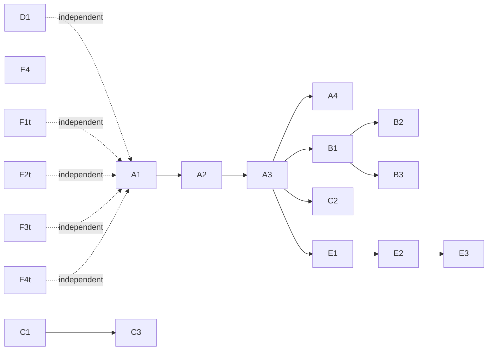

# Agent Harness Security: Implementation Tickets

This page turns the [Agent & Harness Security review](/docs/agent-harness-security-review)
into tickets. Each ticket names the files to touch, the types and functions to
add, the tests to write first, and the commands that prove it is done. Work in
phase order; within a phase, tickets are independent unless a dependency is
named.

**Status (2026-11-12):** Phase A (A1–A4) is **shipped**. Phases B–F are
**planned**; the primitives they build on (peer auth, memfd delivery, session
CA, seccomp, `policy.toml`, audit chain) are shipped.

| Ticket | State | Evidence |
| --- | --- | --- |
| A1 `authz::Grant` | shipped | `crates/kepr-core/src/authz.rs`, `authz_tests.rs` |
| A2 `[[tool_rule]]` | shipped | `policy_tools.rs`, `PolicyFile::decide_tool` |
| A3 MCP tuple | shipped | `McpConfig::{grant_for,authorize}`, `Gate.grant`, `mcp_tools` |
| A4 args + SQL class | shipped | `mcp_tools::{db_args,ssh_args}`, `mcp_sql::classify` |

A3/A4 notes: the grant is built from operator flags (`--tenant`, `--workspace`,
`--connector-account`, `--allow-writes`, `--allow-admin`) and fixed when the
gate session starts; `--read-only` cannot be lifted by a tool argument. The SQL
classifier lives in `src/cli_gatex/mcp_sql.rs` (split out of `mcp_pg.rs` to stay
under the 350-LOC file limit).

## Phase A — Composite authorization (F1, F8)

### A1 — `kepr_core::authz::Grant` type

- **File:** `crates/kepr-core/src/authz.rs` (new), export from `lib.rs`.
- **Add:**
  ```rust
  pub struct Grant {
      pub actor: Identity,
      pub tenant: String,
      pub workspace: String,
      pub tool: String,
      pub connector_account: String,
      pub resource: Vec<String>, // globs
      pub action: Vec<String>,   // query | write | send | delete | admin
  }
  pub enum Decision { Allow, Deny, NeedsApproval }
  pub fn decide(grant: &Grant, req: &GrantRequest) -> Decision;
  ```
- **Tests first:** workspace mismatch → Deny; tenant mismatch → Deny; resource
  glob hit → Allow; action not listed → Deny; empty resource → Deny.
- **Done:** `cargo nextest run --release -p kepr-core authz`.

### A2 — `[[tool_rule]]` in `policy.toml`

- **File:** `crates/kepr-core/src/policy.rs` (extend), `policy_glob.rs` reuse.
- **Add:** `ToolRule { effect, tools, actions, resources, tenants, workspaces,
  role, connector_account }`; extend `PolicyFile` with `tool_rules`; extend the
  first-match evaluator with `fn decide_tool(&self, caller, req) -> Decision`.
  Keep `deny_unknown_fields`.
- **Tests first:** no file → allow; file present, no matching rule → deny;
  first match wins; tenant rule blocks personal account; typo key → parse error.
- **Done:** `cargo nextest run --release -p kepr-core policy`.

### A3 — Bind the tuple in the MCP session

- **Files:** `src/cli_gatex/mcp_config.rs`, `mcp_session.rs`, `mcp_tools.rs`.
- **Change:** add `tenant`, `workspace`, `connector_account` to `McpConfig`;
  carry a `Grant` on `GateSession`; check `authz::decide` on every `db_query`
  and `ssh_run` before touching the target. No reauthorization on gate loss
  (existing invariant).
- **Tests first:** personal-account crossover → refused; workspace mismatch →
  refused; allowed tuple → executes; write without `write` action → refused.
- **Done:** `cargo nextest run --release cli_gatex`.

### A4 — Tool-argument schema validation and SQL statement class

- **Files:** `src/cli_gatex/mcp_tools.rs`, `mcp_pg.rs`.
- **Add:** validate args against the declared JSON schema (small in-tree
  validator; do not add a heavyweight dep); for `db_query`, require exactly one
  statement, refuse `;` chaining and DDL unless the rule action allows `admin`.
- **Tests first:** two statements → refused; trailing `;` → refused; `DROP`
  without admin → refused; schema-invalid args → refused.
- **Done:** `cargo nextest run --release mcp_tools`.

## Phase B — Durable decisions (F2, F9)

### B1 — `DecisionRecord` written before execution

- **Files:** `crates/kepr-gate/src/journal.rs`, `crates/kepr-core/src/gate_journal.rs`.
- **Add:** `intent_id = blake3(session || tool || canonical_args_digest || nonce)`;
  `DecisionRecord { intent_id, actor_ref, tenant, policy_version, sensitivity,
  destination, action, decision, approval_ref, expiry }`. Write it and fsync
  **before** the tool runs; fail closed if the write fails.
- **Tests first:** write failure → action does not run; record precedes result;
  intent_id stable for identical args, distinct for different args.
- **Done:** `cargo nextest run --release -p kepr-gate journal`.

### B2 — Result record, idempotency, reconciliation

- **Files:** `journal.rs`, `daemon_gate_service.rs`.
- **Add:** `ResultRecord { intent_id, outcome: Ok|Err|Unknown, digest }`; on
  restart, reconcile intents with no result and mark `Unknown` explicitly.
- **Tests first:** kill between intent and result → on restart the intent is
  `Unknown`, not silently dropped.
- **Done:** integration test in `tests/`.

### B3 — Actor-resolution store

- **Files:** `crates/kepr-gate/src/journal.rs`, daemon side.
- **Add:** a separate, access-controlled map from `actor_ref` to identity;
  journal carries only the ref.
- **Tests first:** journal line contains no identity; resolution file is 0600
  and owner-only.
- **Done:** `cargo nextest run --release journal`.

## Phase C — Provenance and injection defense (F3)

### C1 — `Provenance` on ingested content

- **Files:** `crates/kepr-gate/src/prompt.rs`, `responses.rs`.
- **Add:** `Provenance { source_id, content_hash, trust: Trusted|Untrusted }`;
  wrap untrusted items in a typed envelope; never let untrusted content sit in
  the `system`/`instructions` position.
- **Tests first:** fetched content cannot occupy an instruction slot; trust
  defaults to Untrusted; explicit rule required to mark a tool Trusted.
- **Done:** `cargo nextest run --release -p kepr-gate prompt`.

### C2 — Tool-argument validation on the way back

- **Files:** `mcp_tools.rs`, `cli_gatex/mcp_ssh.rs`.
- **Add:** model-supplied paths, URLs and recipients must resolve against the
  grant before execution; reject anything outside the granted resource globs.
- **Tests first:** path outside workspace → refused; URL to unapproved host →
  refused; recipient not in grant → refused.
- **Done:** `cargo nextest run --release cli_gatex`.

### C3 — Safe markdown and mediated fetches

- **Files:** `crates/kepr-gate/src/rewrite.rs`, `egress.rs`.
- **Add:** no auto remote images in untrusted markdown; sanitize HTML; route
  permitted fetches through the egress broker with final-destination and
  redirect checks (reuse the existing CA host binding).
- **Tests first:** remote image in untrusted markdown → not fetched; redirect
  to an unbound host → refused.
- **Done:** integration test with a local server.

## Phase D — Device-wide egress (F4)

### D1 — Linux cgroup egress policy

- **Files:** `src/cli_agent_egress.rs`, new `src/cli_agent_firewall.rs`,
  `scripts/` helper.
- **Add:** default-deny nftables policy bound to the agent cgroup; allow the
  gate and approved destinations; cover DNS and Unix sockets.
- **Tests first:** non-cooperating process cannot reach the network; rollback
  restores connectivity; offline boot test passes.
- **Done:** `scripts/agent-egress-test.sh` (new) exits 0.

## Phase E — Performance (P1–P7)

### E1 — Session-scoped Aho–Corasick secret matcher

- **Files:** `crates/kepr-gate/src/dlp.rs`, `mask.rs`.
- **Change:** build the matcher once per session from all secret forms; rebuild
  only on credential change. Replace the per-request `forms` Vec.
- **Tests first:** identical verdicts to the current `scan` on the full DLP test
  corpus; matcher rebuild on credential change.
- **Done:** `cargo nextest run --release -p kepr-gate dlp` + benchmark.

### E2 — Streaming scan with a rolling window

- **Files:** `proxy.rs`, `dlp.rs`, `privacy/mod.rs`.
- **Change:** scan as the body streams; skip the privacy transform for
  non-text content types.
- **Tests first:** a secret split across two chunks is still caught; non-text
  content is not transformed.
- **Done:** `cargo nextest run --release -p kepr-gate`.

### E3 — Bounded worker pool for scan/transform

- **Files:** `crates/kepr-gate/src/proxy.rs`, `service.rs`.
- **Change:** move scan/transform to a bounded pool with backpressure, reusing
  the `daemon_pool.rs` pattern.
- **Tests first:** a slow scan does not block other sessions; pool saturation
  returns a bounded error, not unbounded memory.
- **Done:** `cargo nextest run --release -p kepr-gate`.

### E4 — HashMap mapping store; local token estimate

- **Files:** `privacy/mod.rs`, `limits.rs`.
- **Change:** `HashMap<&str, token>` for mappings; add a local token estimate so
  caps hold when the provider omits `usage`.
- **Tests first:** mapping lookup is O(1) (assert via a large mapping set); cap
  enforced without `usage`.
- **Done:** `cargo nextest run --release`.

## Phase F — Hardening and docs (F5, F6, F10, F11)

### F1t — Seccomp allow-list mode behind a flag

- **Files:** `crates/kepr-core/src/seccomp.rs`.
- **Change:** add `allow_list()` alongside `sandbox_denied()`/`gate_denied()`;
  default stays deny-list until the allow-list passes the full suite.
- **Tests first:** allow-list kills on an unlisted syscall; deny-list unchanged.
- **Done:** `cargo nextest run --release -p kepr-core seccomp`.

### F2t — Session CA bound to harness lifetime

- **Files:** `crates/kepr-gate/src/ca.rs`, `src/cli_agent_run.rs`.
- **Change:** hard-fail gate start if the owner-pid watch cannot be established;
  cap CA validity to the harness lifetime.
- **Tests first:** missing owner-pid → gate refuses to start; CA expires with the
  harness.
- **Done:** `cargo nextest run --release`.

### F3t — Capability flag on the privacy preset

- **Files:** `crates/kepr-core/src/privacy/mod.rs`, `kepr status` output.
- **Change:** surface `masking` (not `anonymization`) as a capability; record it
  in the journal.
- **Tests first:** status shows the flag; journal records it.
- **Done:** `cargo nextest run --release`.

### F4t — README and control docs honesty pass

- **Files:** `README.md`, `docs/content/docs/security.mdx`.
- **Change:** rewrite the agent-protection row with the exact caveat; add a
  one-page "what this stops / what it does not" per control. No claim without a
  named mechanism.
- **Done:** docs build (`cd docs && npm run build`) and a manual read-through.

## Sequencing



Phase A is the critical path: nothing else can be enforced correctly until the
composite grant exists. Phase D and Phase F are independent of A and can run in
parallel by a second contributor.
