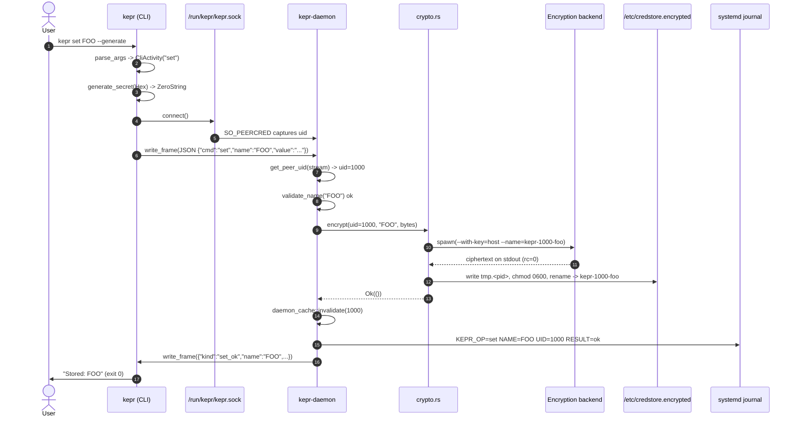
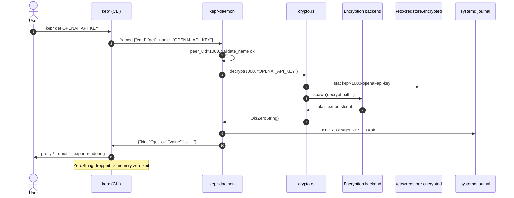
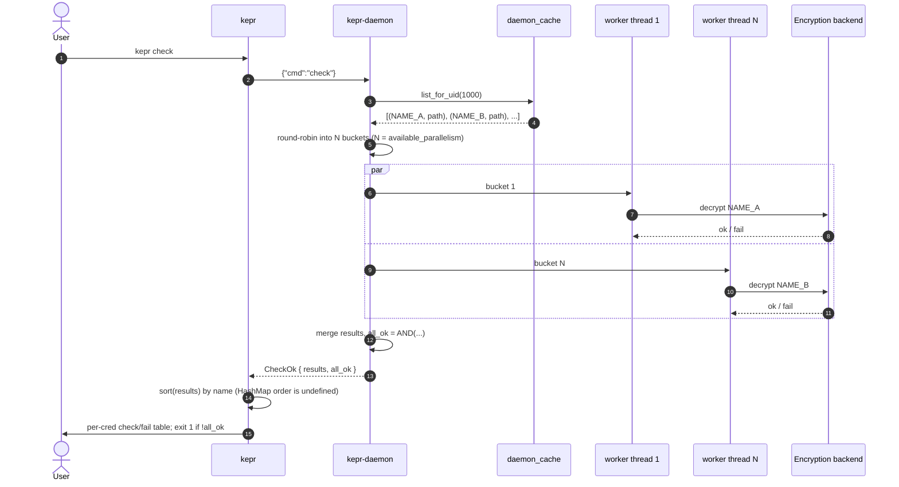
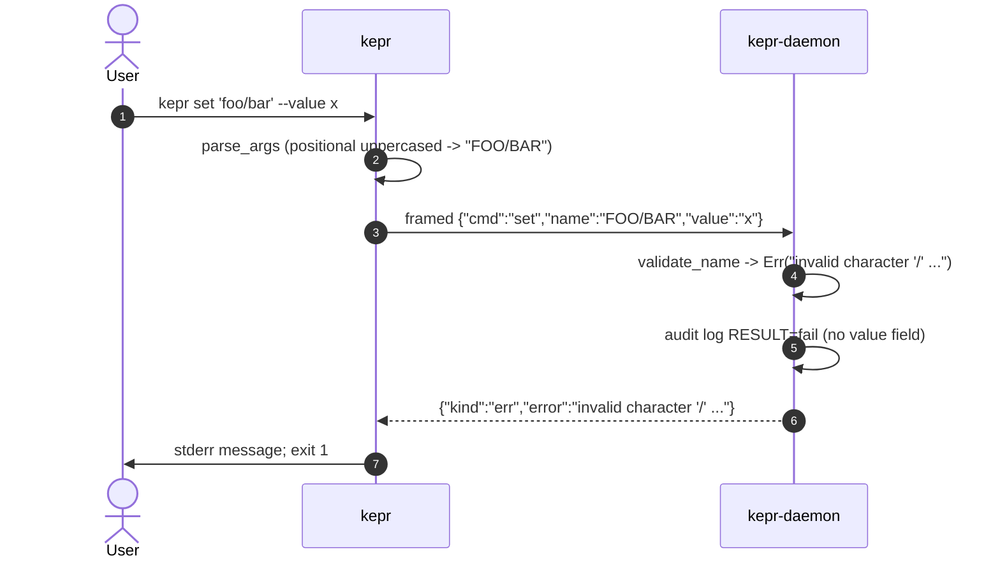
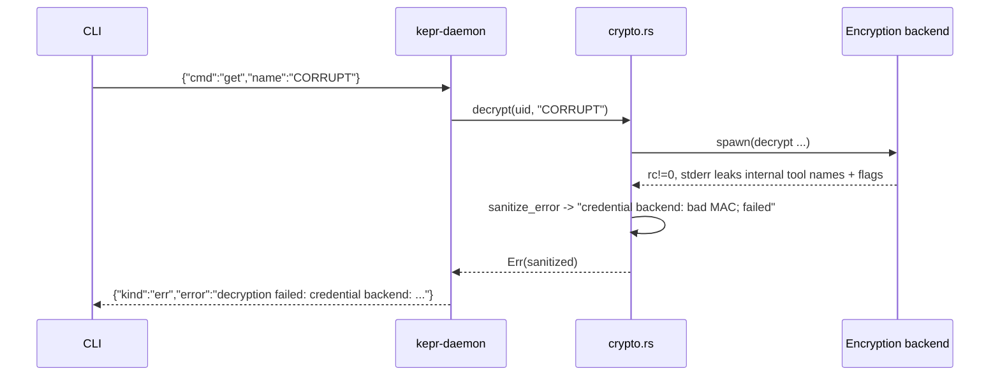

## `kepr set FOO --generate`

## `kepr get OPENAI_API_KEY`

## `kepr check` (parallel verify)

## Rejected request — invalid name

<Info>
  The check runs **inside the daemon**, not just on the client. The
  client uppercase-folds positional args, but `validate_name` in the
  daemon is the actual security boundary against path traversal and
  shell metacharacters.
</Info>

## Decrypt failure with sanitised error

