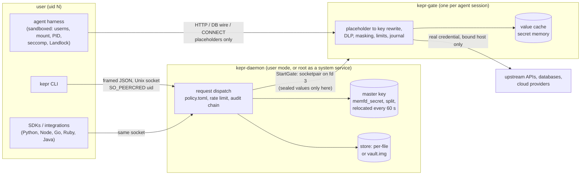
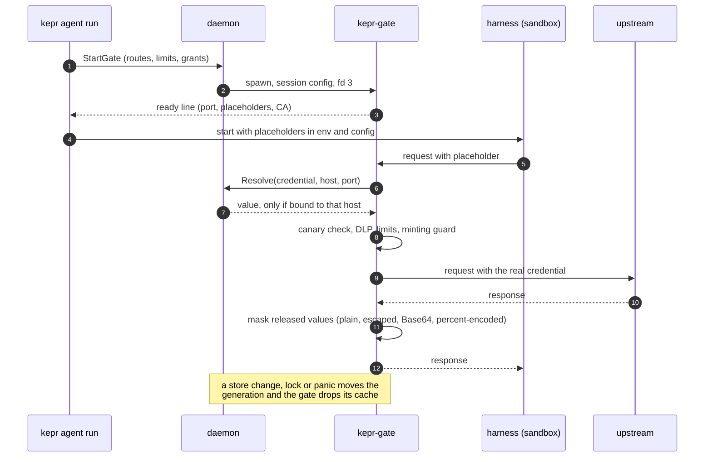
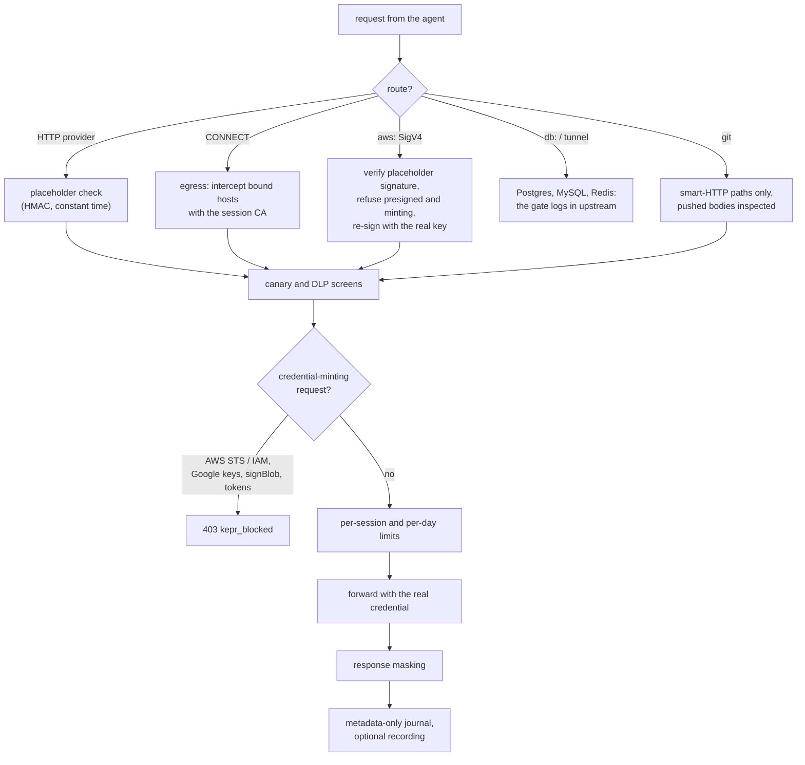
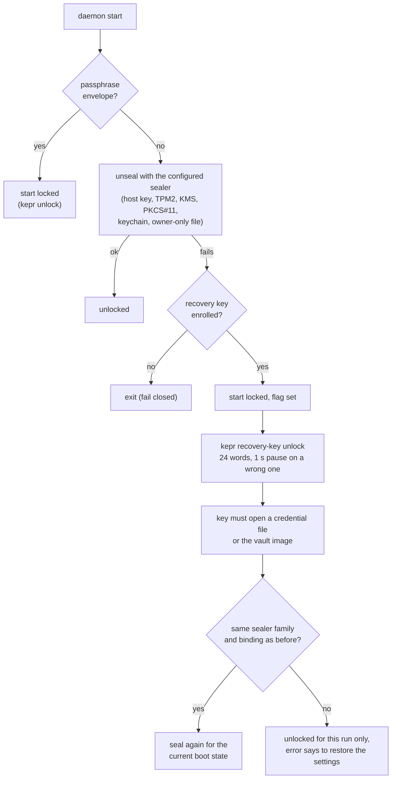
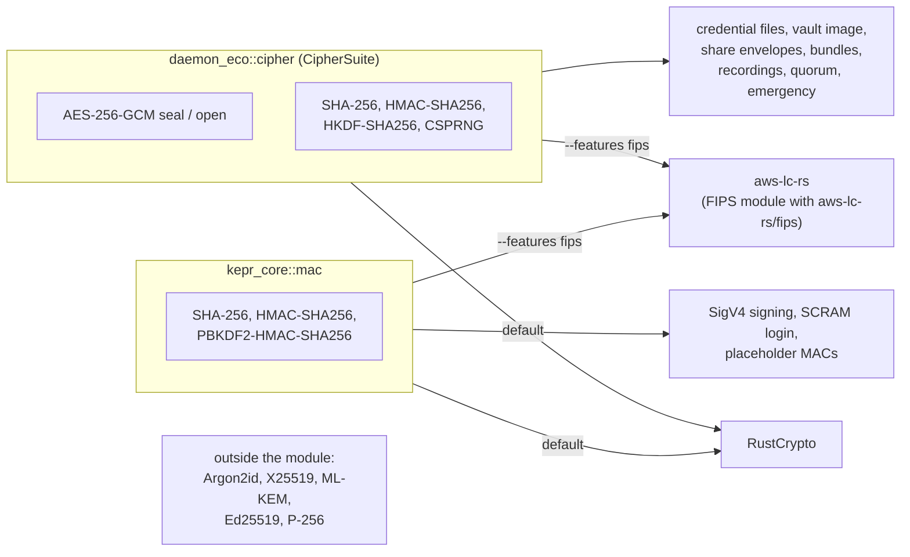
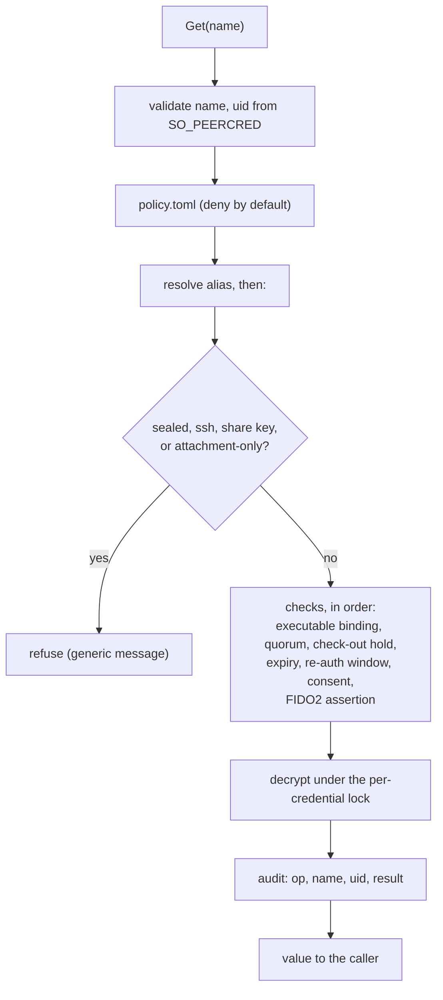
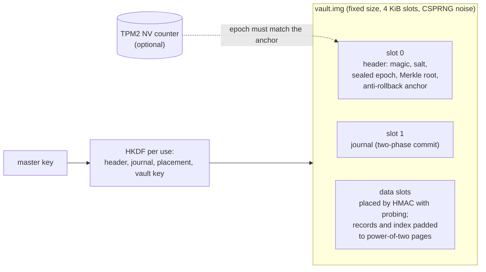
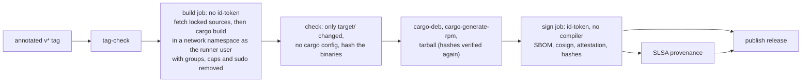

This page draws the system as it is in the tree today (phase P12 shipped).
The [overview](/docs/architecture/overview) covers the original two-process
model; the [plan](/docs/agent-vault-plan) and the
[tickets](/docs/agent-vault-tickets) say why each part exists.

## Processes and trust boundaries

The daemon is the only process that reads the store and the master key. A
sealed credential never leaves it except over the daemon-to-gate pair, and
only for a host in its binding. The agent harness sees placeholders and a
session CA; it has no route to the socket (a hiding mount covers it).

## One agent session

## Inside the gate

## Master key at rest and at start-up

On a macOS keychain store, `kepr lock` and `kepr recovery-key enrol` first
need an Allow in a dialog (T12.53). The recovery kit, recovery words, break
glass and escrow are the other documented ways key material leaves the
daemon; each has its own fences (see the plan, section 5).

## Crypto layer and the FIPS build

Formats are byte-identical in both builds, and tests pin outputs of the
earlier code, so a store written by one build opens in the other.
`tests/crypto_seam.rs` fails if a file outside the seam names the crates
directly.

## Reading a credential

## Vault image layout

## Release pipeline

