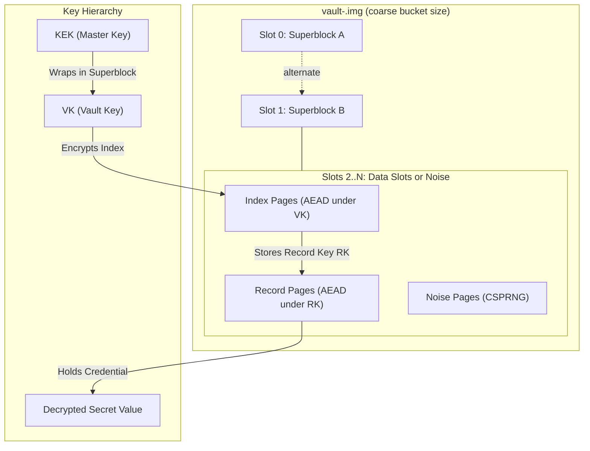

**Status:** plan, not built. P4.3 (TPM2 sealing of the master key) has
already shipped. This page covers P4.1 (the image format) and P4.2
(per-record keys, crypto-shred, `kepr vault`). Decisions still open are
listed at the end.

## Why change the storage

Today every credential is one file, `kepr-<uid>-<name>` in
`/etc/credstore.encrypted/` (system mode) or `~/.local/share/kepr/credentials/` (user mode).
Each file holds AES-256-GCM ciphertext bound to `(uid, name)`, and has a
plaintext `<cred>.meta` JSON sidecar beside it. The values are safe. A copy
of the directory (a backup, a stolen disk, a VM snapshot) still shows:

| Visible today without any key | Example |
| --- | --- |
| Every credential name, per user | `kepr-1000-stripe_live_key` |
| How many credentials each user has, and which uids use kepr | file count |
| Value sizes, exactly, minus a fixed 44 bytes | file size |
| When each one was last changed | mtime |
| Policy and bindings, in plaintext `.meta` | `sealed`, bound hosts, `record_type`, expiry, consent flags |
| Recently deleted values | blocks still on disk, or in older backups |

The vault image puts all of that inside one encrypted file per user. Names,
counts, sizes, policies and bindings all become ciphertext. Free space is
indistinguishable from data. A delete destroys the record's key, not just
the file name.

**Not in scope:** the live daemon's memory and root on the running host.
Root can read the daemon's memory today and still could. The image protects
copies at rest, which is where the current layout leaks.

## Design at a glance



### Slots

- Each slot is 4 KiB. A slot is `nonce (12) ‖ AES-256-GCM ciphertext ‖
  tag (16)`.
- The AAD of every slot is `"keprimg1" ‖ uid ‖ slot index ‖ write
  generation`. A slot copied to another position, another image, or an
  older generation fails to decrypt.
- **Unused slots** are filled from the CSPRNG when the image grows and
  whenever a slot is freed. Without the keys they look exactly like data
  slots.
- **Record pages:** a value up to the 64 KiB protocol limit takes 1 to 17
  slots. It is padded to a whole number of slots, so sizes leak only to
  4 KiB granularity.
- **Image size:** the image grows in powers of two, never below 1 MiB (256
  slots). The size reveals only a coarse bucket, not the record count.
- **Shrinking:** `kepr vault compact` shrinks the image explicitly. It is
  never automatic, so a delete doesn't shrink the file.

### Superblock and commit (crash safety without a journal)

Writes are copy-on-write:

1. Write the new record pages and the changed index pages into **free**
   slots, then `fsync`.
2. Write the **inactive** superblock with `generation + 1`, the new index
   root hash and the slot map, then `fsync`.
3. Turn the slots freed by this commit into noise. This step can be lost:
   on the next start, slots that no index references are turned into noise
   anyway.

A crash before step 2 leaves the old superblock current, with the old state
intact. A crash after step 2 leaves the new state. A torn superblock write
fails its AEAD tag, so the other copy wins. No separate journal is needed.

The superblock holds:
- magic, format version, uid, generation;
- the KEK-wrapped VK;
- the slot-map root and the index root hash;
- its own AEAD tag under the VK, with the KEK-wrapped VK authenticated as
  AAD.

### Integrity and rollback

The hashes form a depth-2 Merkle tree. The superblock commits to the index
root, and each index entry commits to its record's content hash and slot
list. A changed byte anywhere is detected: it either fails AEAD or fails a
hash, or it sits in a noise slot, where it is harmless.

Rolling back the **whole image** to an older copy is caught the way
per-credential counters are caught today (`cred-versions.json`): the daemon
keeps the last generation per uid in the root-only state directory and
refuses an image with a lower one. With P4.3's TPM, an NV monotonic counter
can hold that number instead, so not even root can roll the image back
unnoticed.

### Per-record keys and crypto-shred (P4.2)

Every record has its own random 32-byte key RK, stored only in its index
entry. Deleting a record (or expiry, or `kepr leaked`) does three things in
one commit:
- drops the index entry, so RK is gone from the current index;
- turns the record's slots into noise;
- re-encrypts the changed index pages under fresh nonces.

**What this guarantees, honestly:**

| Attacker has | After a delete, can they read the value? |
| --- | --- |
| The current image only | No: the key and the data are both gone. |
| An older image, but not the KEK | No: same as today. |
| An older image **and** the KEK | Yes, with the KEK alone. The old superblock still wraps the old VK. |
| An older image, the KEK, **and** a TPM NV epoch (P4.3 follow-up) | No. Each delete advances an epoch that is mixed into the VK wrapping, so old superblocks can no longer be unwrapped on that machine. |

The docs and `kepr vault status` must say which row applies on each host.

### What moves into the image

Everything the daemon stores per credential becomes a record **kind** in
the index:
- `value`;
- `history` (today's `NAME~slot` creds);
- `ssh` (sign-only keys);
- `share-key`;
- `fido2` (today's separate files);
- each record's `CredMeta` (expiry, consent, FIDO2, sealed, bindings,
  record type).

The `.meta` sidecars disappear.

The access-control boundary doesn't change: the daemon only ever opens
`vault-<peer uid>.img`, chosen by the uid from `SO_PEERCRED`. Names are
still validated with `store::validate_name` before any lookup.

## Code plan

The first step is a refactor with no behaviour change. About twenty daemon
files reach into the file layout directly: `store::cred_path`,
`list_for_uid`, `meta_path_for`, `file_mtime_str` and `file_size`. They are
`daemon_handlers*`, `daemon_history`, `daemon_expiry`, `daemon_ssh`,
`daemon_share`, `daemon_health`, `daemon_usage`, `daemon_records`, `fido2`,
`daemon_recovery`, `daemon_gate*`, `daemon_cache` and `crypto*`. All of
them move behind one interface:

```rust
pub trait Store: Send + Sync {
    fn get(&self, uid: u32, name: &str, kind: Kind) -> Result<Option<Record>, StoreError>;
    fn put(&self, uid: u32, name: &str, kind: Kind, value: &[u8], meta: &CredMeta) -> Result<(), StoreError>;
    fn delete(&self, uid: u32, name: &str, kind: Kind) -> Result<(), StoreError>; // crypto-shred in the image store
    fn list(&self, uid: u32) -> Result<Vec<Entry>, StoreError>;               // names, kinds, meta, updated_at
    fn meta(&self, uid: u32, name: &str) -> Result<Option<CredMeta>, StoreError>;
}
```

There will be two implementations:
- `FileStore`: today's layout, unchanged on disk.
- `ImageStore`: the vault image.

`updated_at` comes from the index for the image store, and from mtime for
the file store.

| Where | What |
| --- | --- |
| `crates/kepr-core/src/vault_image/` | The format only: superblock and slot encode/decode, AAD layout, index (de)serialisation, Merkle hashing. No IO, so it is fuzzable (`fuzz_targets/image_fuzz.rs`) and proptest-able. |
| `src/store_api.rs` | The `Store` trait, `Kind`, `Record`, `Entry`, `StoreError`. |
| `src/store_file.rs` | `FileStore`, wrapping today's `crypto_inproc` and `expiry` code. |
| `src/store_image.rs` + `src/store_image_commit.rs` | `ImageStore`: per-uid `Mutex`, the decrypted index cached in mlocked memory, `pread`/`pwrite` of slots, and the commit protocol. |
| `src/daemon_vault.rs` | Handlers for `VaultStatus`, `VaultMigrate`, `VaultVerify`, `VaultExport` and `VaultCompact`, with audit. |
| `src/cli_vault.rs` | `kepr vault status \| migrate [--finish] \| verify \| export-files \| compact`. |

**No new dependencies.** `aes-gcm`, `sha2`, `hkdf`, `getrandom` and
`zeroize` are already in the tree. `proptest` and `tempfile` are already
dev-dependencies.

## Migration and rollback

Each uid is either on files or on the image, never both. A marker
`storage-<uid>` in the state directory records which. The daemon picks the
`Store` per uid at request time.

1. **`kepr vault migrate`** (per user; root can run `--all` in system mode).
   1. Read every record through `FileStore` and write them all into a new
      `vault-<uid>.img.new` in one commit.
   2. Re-open that image, decrypt every record, and compare it with the
      source by SHA-256.
   3. On a match, `rename` it to `vault-<uid>.img` and set the marker. The
      migration is audited.
   4. The old files are kept, made read-only, and listed by
      `kepr vault status` as "legacy copy kept".

   Any mismatch aborts before the marker changes.
2. **`kepr vault migrate --finish`** (explicit; no time-based deletion).
   It overwrites the legacy files with random data, best-effort (SSDs may
   keep copies; the docs say so), then deletes them and their `.meta`
   sidecars.
3. **Rollback: `kepr vault export-files`.** It writes the legacy layout
   back from the image with the same verify step, then sets the marker
   back to files. The image is kept until `export-files --finish`.
   Rollback is possible at any time, not only before `--finish`.
4. **New installs:**
   - First release: the file store stays the default, and
     `KEPR_STORAGE=image` opts in.
   - The next release flips the default for new users, once the image has
     shipped in one release with no format changes.
   - Existing users migrate only when they run `kepr vault migrate`.

## Testing

| Test | How |
| --- | --- |
| Format round trip | proptest: random record sets, then encode, decode, and compare. |
| Crash safety | Run every write through a fault-injecting file wrapper that can stop after any `pwrite`/`fsync`, including a torn 4 KiB write. Reopen after each stop: the state must be the old one or the new one, never a mix or a failure. |
| Tamper detection | Flip each byte of a small image in turn. Every flip is either detected (AEAD or hash) or lands in a noise slot. Records are never silently changed. |
| Rollback | Save image generation N, commit N+1, put N back: refused. |
| Indistinguishability | A chi-square test that noise slots and data slots have the same byte distribution, and that image size depends only on the bucket. |
| Fuzz | `image_fuzz` against the superblock, index and slot decoders (kepr-core, no IO). |
| Parity | The existing daemon handler tests run against both `FileStore` and `ImageStore` through the trait, as a behaviour contract. |
| Migration e2e | `agent_e2e.sh`: migrate, check every command, export back, check again. Sealed credentials, SSH keys, history, records and shares all survive the round trip. |
| Performance | `get` within 10% of the file store, warm. `set` within 2× (two fsyncs instead of one rename). Measured, and recorded in `docs/reference/testing.mdx`. |

## Tickets

Each one is a PR of its own, in this order.

| Ticket | Size | Content | Done when |
| --- | --- | --- | --- |
| P4.1a | M | The `Store` trait and `FileStore`. Every handler goes through it. No behaviour change. | The full suite and `agent_e2e.sh` pass unchanged. No direct `cred_path` use outside `store_file.rs`. |
| P4.1b | M | `kepr_core::vault_image`: format, AAD, superblock, index, Merkle. | Proptests, a fuzz target, and a written format spec in `crypto-spec.mdx`. |
| P4.1c | L | `ImageStore`, the commit protocol, noise fill, growth buckets. | Crash, tamper and rollback suites green. Parity suite green. |
| P4.2a | M | Per-record keys, crypto-shred delete, scrubbing at start-up. | Delete and expiry tests prove the slots and the key are gone from the current image. |
| P4.2b | M | `kepr vault status/migrate/verify/export-files/compact`, audit ops, docs. | Migration e2e in both directions. |
| P4.2c | S | `KEPR_STORAGE=image` opt-in, then the default for new installs one release later. | A release note, and `kepr doctor` reports the storage mode. |
| P4.3b | M | TPM2 NV epoch (anti-rollback + crypto-shred against old copies), behind `tpm2`. | A rollback test with swtpm, and the crypto-shred table row verified. |

## Open decisions

1. **One image per user, or one shared image.** The recommendation is one
   per user:
   - smaller blast radius;
   - per-user locking and backup;
   - deleting a user is one file.

   It still reveals which uids use kepr, as file names already do today. A
   shared image would hide that, but serialises every user's writes and
   makes per-user export harder.
2. **Slot size.** 4 KiB matches page size and SSD write units. 1 KiB would
   leak less about sizes but cost more index space and more slots per
   record.
3. **Default for new installs.** The recommendation is opt-in first, then
   the default after one release.
4. **Whether to keep `FileStore` for good.** The recommendation is yes:
   it's the rollback path and the parity reference, and it costs little
   once it sits behind the trait.
