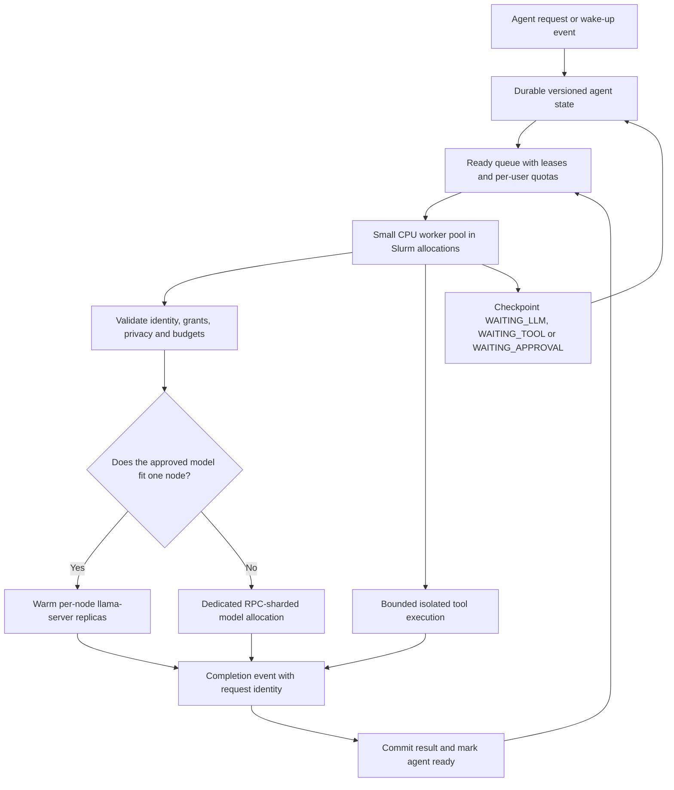

# Efficient agents on the current cluster

The cluster described by the operator uses Linux nodes, Slurm and llama.cpp
RPC, with CPUs only. Its node count, physical cores, RAM, NUMA topology,
interconnect speed, llama.cpp revision, models and existing throughput have
not yet been measured in this review.

The practical recommendation is to **park waiting agent state, keep a small
active worker pool, and keep model servers warm**. When a model fits one
node's RAM, compare independent per-node llama-server replicas with the
existing RPC-sharded configuration. Use the measured result to choose the
deployment, rather than assuming that more RPC nodes means faster inference.

This is a design and pilot plan. No Slurm jobs were submitted, cluster nodes
were queried, services were restarted or infrastructure was changed.

## What the video actually shows

Source: [Agentic Conversations, Instagram reel DfUowKHhm7i](https://www.instagram.com/p/DfUowKHhm7i/).
The public clip is about 73.4 seconds long. Its caption says:
“75,000 agents on a Raspberry Pi... how?”

The video was accessible without login. This review inspected its public
rendered video and on-screen captions in 29 frames sampled every 2.5 seconds.
That supports the scheduling explanation below; it is not an independently
reproduced performance benchmark or a full audio transcript.

| Video window | Observable explanation |
| --- | --- |
| About 5–15 seconds | An agent occupies an OS process/thread, including while waiting for a tool; this restricts capacity. |
| About 20–33 seconds | Serialize the agent's state, release the execution worker, then resume the agent when work is ready. |
| About 37–50 seconds | A timeline shows small active computation segments interleaved with waiting. |
| About 55–71 seconds | The speaker describes many concurrent agents, with most waiting and available to suspend. |

The clip does not establish 75,000 simultaneous local LLM generations. It
does not provide the model, request rate, token rate, latency, state size,
hardware configuration or reproducible workload needed to validate that
headline. Treat it as a demonstration of efficient waiting and scheduling.

## Where it helps this cluster

Separate three quantities:

- **Logical agents:** saved workflows, conversation references, grants and
  pending events. Many can be waiting without an execution thread.
- **Active agent steps:** bounded workers running planning, orchestration or
  sandboxed tools. These need CPU/RAM only while active.
- **Active inference slots:** llama-server requests using model CPU time and
  context/KV memory. They remain expensive even if their agent controller is
  suspended.

A controller awaiting a model response can release its execution worker.
The model computation does not become free. If CPU inference already
saturates memory bandwidth, the technique can lower orchestration memory
without materially improving generated tokens per second.

For the full population, measure dormant-state bytes rather than counting
threads. For active work, bound inference slots, input/output tokens, tool
processes and RPC traffic separately. Avoid a process, thread, Slurm job or
model instance for every dormant logical agent.

## Proposed data and execution flow

The diagram describes new integration work. Kepr does not currently implement
the durable scheduler or a qualified local llama.cpp inference route.

## 1. Make agent execution resumable

Represent each agent with explicit states such as `READY`, `LEASED`,
`WAITING_LLM`, `WAITING_TOOL`, `WAITING_APPROVAL`, `COMPLETED`, `FAILED` and
`CANCELLED`.

Persist a versioned, bounded record containing the next step, immutable
identity/grant references, conversation/artifact references, pending request
ID, deadline, retry count and budget consumption. At a wait boundary, commit
the record and return the worker to the pool. Resume only after the matching
completion event is committed.

Do not assume that an arbitrary Python coroutine, OS process, socket or
thread can be serialized safely. Implement a state machine or a workflow
runtime with explicit checkpoint semantics. Avoid loading untrusted pickle
objects or evaluating stored code.

Never persist provider API keys, gate placeholder values, live socket handles
or transient approvals in an agent checkpoint. Store approved credential
names/grant references and establish fresh authorized sessions when needed.
Preserve tool-call links and opaque/signed conversation state without
rewriting it. Checkpoint data can contain personal content and needs its own
local access control and encryption.

Use transactional leases with expiry and renewal. Add idempotency identities
for tool operations so a worker crash after an email or write does not cause
a duplicate action on recovery. Human approvals bind to the exact permitted
action, recipient/content identity and expiry; a replay cannot authorize a
different write.

Do not use a multi-writer SQLite database on shared NFS as the distributed
queue. Use a storage design whose locking and recovery semantics are
qualified for the filesystem, or a transactional service. Node-local SQLite
can serve a bounded single-node pilot.

## 2. Let Slurm allocate resources, then schedule agent steps inside them

Slurm remains responsible for CPU/RAM allocation, accounting, partitions and
fairness. A small number of long-lived allocations runs model servers and
agent workers. Each worker allocation processes many agent steps over its
lifetime rather than submitting a fresh batch job for each LLM/tool wait.

Job arrays remain useful for coarse batch runs. Slurm's official documentation
supports a running-task cap with `%`, such as `--array=0-15%4`. Arrays still
count against configured job limits and their maximum size is an administrator
setting. They do not eliminate the runtime cost of starting a full harness
for every task.

Place CPU generation threads within the Slurm cpuset. Request RAM for model
weights, contexts/KV cache, prompt caches and runtime overhead together.
Checkpoint agent work before allocation walltime expiry or preemption, and
release leases and pending requests on cancellation.

For an RPC-sharded model, allocate the coordinator and its CPU shard nodes
as one managed model group. Advertise the service only after every assigned
shard is healthy. A shard or allocation failure invalidates the group's
in-flight requests; recovery must not repeat already completed tool writes.

## 3. Prefer warm replicas when the model fits RAM

For CPU-only nodes, independently loaded replicas can process separate
requests without sending model computation through the inter-node RPC path.
Model weights stay loaded, while an admission queue feeds a measured number
of slots. This improves utilization without reloading a model per agent.

Choose a quantized model that fits the allocated node RAM with enough
headroom for context/KV memory. Benchmark the smaller local model before
assuming the largest model gives an acceptable interactive latency. Mixture
of experts does not mean all model weights can be omitted from resident
storage, and quantization does not remove context memory or networking costs.

Pin routing for a conversation or common trusted prefix when that helps cache
reuse. Scope caches to authorized users/data classes. An inference-slot/KV
snapshot is distinct from an agent checkpoint; retaining a KV snapshot for
every dormant agent can erase the memory saving.

## 4. Keep RPC sharding for a measured requirement

The llama.cpp RPC backend exposes remote ggml devices, and a CPU-only host
exposes a CPU device. It distributes model weights and KV cache across
available devices, with placement adjustable by `--tensor-split`. This is
distributed model computation, not a scheduler for independent agent states.

When a model does not fit one node's RAM, RPC can make it executable across
nodes. That is a capacity improvement; throughput or latency can still be
worse because of transport latency, activation transfer and synchronization.

Measure load time, first-token latency, prompt processing, generated tokens
per second, network bytes and p95 request time for local replicas versus the
smallest necessary RPC group. If sharding is needed, compare only feasible
configurations and report the RAM constraint explicitly.

The RPC tensor cache (`ggml-rpc-server -c` in current upstream documentation)
can reduce large tensor transfers during model loading. It is not a cache
that eliminates computation for new prompts. Use node-local storage with a
quota rather than an unlimited shared-network cache.

RDMA support in current upstream is optional and negotiated. Do not assume
this cluster has RDMA-capable NICs or a matching build; ordinary TCP remains
a valid baseline and its overhead must be measured.

## 5. Tune CPU, context and batching with measurements

The current upstream llama-server documentation exposes these controls.
Validate them against the installed revision before scripting a rollout.

| Control | What to measure |
| --- | --- |
| `--threads` | Decode performance across physical core counts without exceeding the Slurm cpuset. More threads can lose to bandwidth/coordination overhead. |
| `--threads-batch` | Prompt-processing throughput, separately from generation threads. |
| `--numa` and CPU affinity | NUMA placement and memory locality on the actual allocated sockets; do not globally drop host caches during normal cluster operation. |
| `--parallel` | Begin with 1, 2, 4 and 8 slots in a synthetic pilot, stopping before RAM pressure or unacceptable p95 latency. A slot count is not the number of logical agents. |
| `--cont-batching` | Current upstream enables continuous batching by default. Measure aggregate throughput and per-user fairness with mixed prompt sizes. |
| `--ctx-size` | Set a finite context budget; verify the installed build's slot/unified-KV allocation semantics instead of assuming a per-slot size. |
| `--batch-size`, `--ubatch-size` | Prompt throughput, scratch-memory pressure and latency for long prompts. |
| `--cache-ram`, prompt reuse | Cache hit rate and bounded RAM. Keep private contexts isolated and do not reserve every parked agent's KV cache. |
| `--metrics` | Collect model-server load/timing metrics on an operator-only endpoint. Protect slot and administrative endpoints as well. |

Put backpressure before the inference queue. Admit work against available
slots and token/RAM budgets; otherwise leave the agent parked. Apply per-user
quotas, prompt/output-token limits, request deadlines and bounded retries.
Cancellation must propagate to the actual model/tool request, not merely
hide its result while CPU work continues.

## 6. Preserve the security boundary

The [upstream RPC README](https://github.com/ggml-org/llama.cpp/blob/master/tools/rpc/README.md)
currently calls the RPC implementation fragile/insecure and says:
**“Never run the RPC server on an open network or in a sensitive environment!”**
That is an explicit upstream constraint, not a conclusion that Kepr fixes it.

An authenticated HTTP entrypoint does not make the tensor RPC backplane
authenticated, encrypted or safe against malformed requests. Private network
placement and a tunnel do not repair backend memory-safety defects. Prefer
qualified per-node serving for sensitive data. Limit any RPC pilot to isolated
non-sensitive fixtures until the transport and implementation are qualified
for the intended threat model.

Keep model/tool services within their allocated resource and network scope.
Do not expose daemon credential sockets to agents or introduce a shared
service account that gives mutually untrusted users the same credential
scope. Trusted orchestration can be pooled; untrusted tools still need
separate isolation and grants.

Current Kepr permits at most **16 active gates per OS UID**. Many dormant
agent records do not require one gate each, but pooling must preserve user,
credential, budget and privacy-session attribution. Raising the limit to
75,000 or sharing one unrestricted gate between tenants is not an efficiency
solution. Local inference routing and enterprise per-actor attribution need
new Kepr integration; they are not available launch flags today.

## A measurable pilot

1. Record the node/core/RAM/NUMA/network inventory, installed llama.cpp
   revision, approved local model/quantization and current Slurm allocation
   constraints. Use read-only operator inventory; do not inspect credentials.
2. On one bounded CPU allocation, run a warm model server and a small
   resumable-agent prototype. Use a synthetic workload with fixed prompt and
   output-token lengths, plus controlled tool waits.
3. Compare 100, 1,000 and 10,000 dormant agent records with the active worker
   count fixed. Record bytes per parked agent and resume latency. These are
   proposed test sizes, not measured capacities.
4. Sweep inference slots and thread counts. Capture completed useful tasks
   per minute, aggregate output tokens per second, p50/p95 first-token and
   completion times, RSS, CPU time, memory pressure, network bytes and queue
   age. Keep workload and quality criteria identical across runs.
5. Compare one-node replicas with the existing RPC path. Separate cold model
   load, warm prefill, decode and queuing time so tensor caching is not
   mistaken for faster steady-state generation.
6. Exercise worker kill, Slurm expiry/preemption, one shard failure,
   cancellation, queue saturation and duplicate completion events. Pass
   only if state is recovered, unauthorized operations remain blocked and
   side effects are not repeated.
7. Expand only the configuration that improves useful throughput or lowers
   orchestration memory while meeting the chosen p95 latency and quality
   targets. Preserve the prior allocation/service configuration for rollback.

No speedup percentage or 75,000-agent capacity should be promised before
that pilot. A successful orchestration benchmark and a successful CPU model
benchmark establish different facts.

## References and local evidence

- [Public video](https://www.instagram.com/p/DfUowKHhm7i/), reviewed via public playback and sampled on-screen captions.
- [Slurm job arrays](https://slurm.schedmd.com/job_array.html), retrieved for running-task caps and administrator size/job limits.
- [llama.cpp RPC](https://github.com/ggml-org/llama.cpp/blob/master/tools/rpc/README.md), retrieved for CPU devices, weight/KV placement, tensor caching, RDMA and the explicit security limitation.
- [llama-server](https://github.com/ggml-org/llama.cpp/blob/master/tools/server/README.md), retrieved for CPU/thread, slots, context/cache, batching, metrics and HTTP authentication/TLS controls.
- Local source: `src/daemon_gate_registry.rs` pins 16 active gates per UID; `crates/kepr-core/src/gate_limits.rs` and `src/cli_gatex/mcp_config.rs` provide bounded request/token contracts.
- The current [Kepr implementation plan](/docs/security-suite-plan) records local inference and device-wide enforcement as unfinished.
